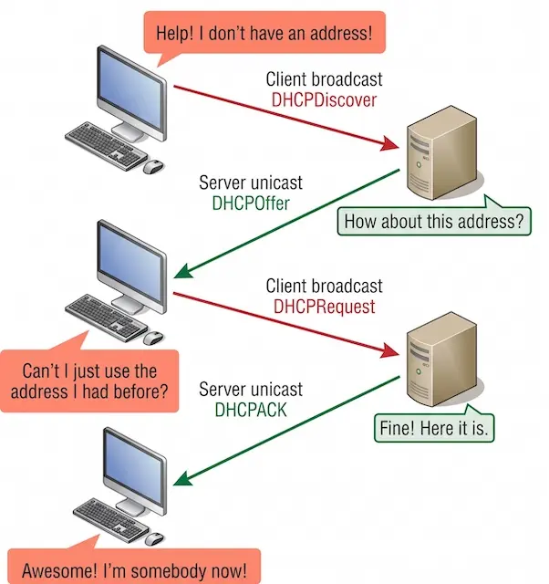
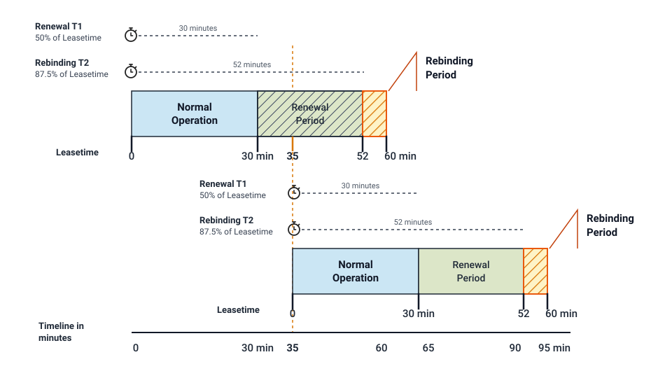
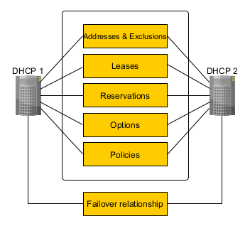
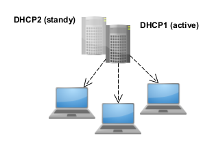
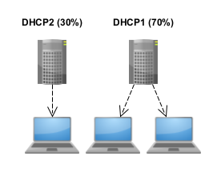
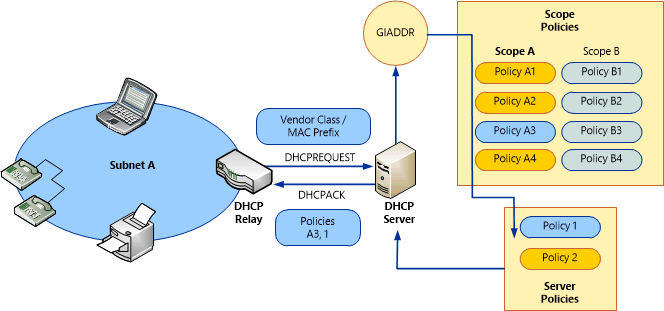
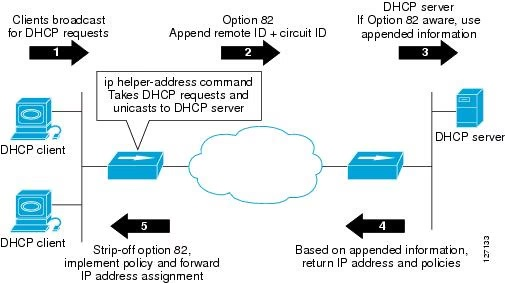
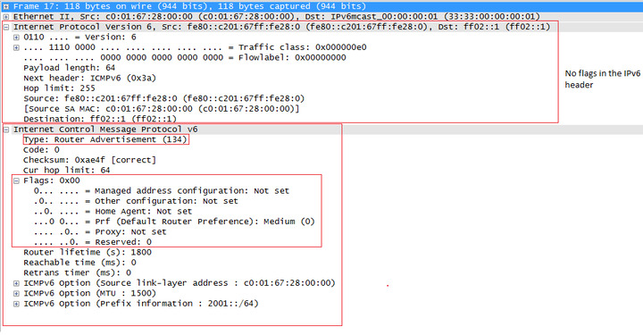
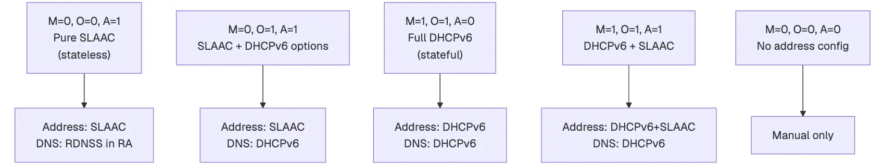
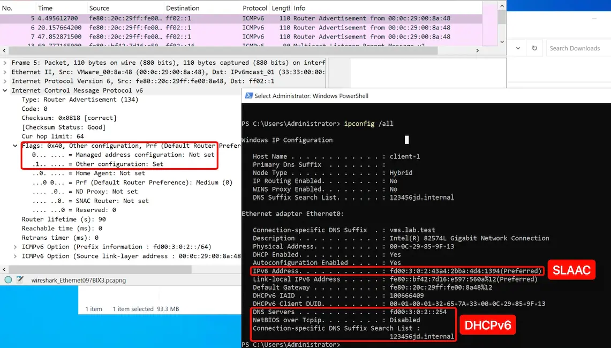

## Advanced Servers

## Advanced Network Services

---

### `DHCPv4` DORA

- **Discover:** The client looks for servers; initial discovery normally uses broadcast.
- **Offer:** A server proposes an address and configuration.
- **Request:** The client identifies the offer it selected.
- **ACK:** The selected server confirms the lease.
- Clients use **UDP 68**; servers use **UDP 67**.

---

### DORA

---

### DHCP Scope

- A **scope** defines a subnet and a pool of addresses.
- **Exclusions** protect addresses; **reservations** associate an address with a client identifier.
- Option **3** supplies an IPv4 router; option **6** supplies DNS servers.
- Option **15** supplies a DNS suffix; option **51** supplies lease time.
- AD clients need DNS servers that can resolve the domain's records.

---

### A Lease Has a Lifecycle

- **T1:** Normally at 50%, the client tries to renew with its leasing server.
- **T2:** Normally at 87.5%, the client tries to rebind with any available server.
- **Expiry:** Without renewal, the client must stop using the leased address.
- A shorter outage may affect new clients before existing clients.
- Without a lease, a Windows client may fall back to **169.254.0.0/16**.

---

### DHCP Lease Lifecycle

---

### Windows DHCP Failover

- DHCP failover allows two Microsoft DHCP servers to share availability information, ensuring high availability by replicating IP address leases and settings between a primary server and its failover partner.
- All scope information is shared between the two DHCP servers, including active leases.
- This enables either DHCP server to assume responsibility for DHCP clients if the other server becomes unavailable.
- DHCP failover supports DHCPv4 scopes only. DHCPv6 scopes can't be failover-enabled.

---

### DHCP Failover Partners

- DHCP servers that share a failover-enabled DHCP scope are called **failover partners**.

Credit: [DHCP failover overview](https://learn.microsoft.com/en-us/windows-server/networking/technologies/dhcp/dhcp-failover)

---

### DHCP Failover Coordination

- Two Windows servers share responsibility for selected **DHCPv4 scopes**.
- Each maintains its own synchronized lease database.
- Partner communication uses **TCP 647**.
- Partners coordinate lease use to reduce conflicting assignments during failures.
- This mechanism does **not** cover Windows DHCPv6 scopes.

---

### DHCP Failover Modes

- **Hot standby mode**: This mode provides redundancy for DHCP services.
- **Load balance mode**: This mode allocates DHCP client leases across two servers.
- You can switch between hot standby and load balance mode if desired, but you can only use one mode at a time with a single DHCP scope.
- You can also use both modes on the same DHCP server if you configure multiple failover relationships.

---

### Hot Standby Mode

- Two servers operate in a failover relationship where an active server is responsible for leasing IP addresses and configuration information to all clients in a scope or subnet.
- The partner server assumes a standby role, with responsibility to issue leases to DHCP clients **only if** the active server becomes unavailable.

---

### Hot Standby Reserve Percentage

- The percentage (5% by default) of IP addresses on the active server that are reserved for use on the standby server if the active server doesn't respond.
- The reserve percentage is used for new DHCP leases.
- If a client renews with an isolated standby DHCP server, the standby keeps the same IP address but only extends the lease for the Maximum Client Lead Time (MCLT) instead of the full duration.

---

### Load Balance Mode

- Load balance mode is the default mode of deployment.
- Two DHCP servers simultaneously serve IP addresses and options to clients on a given subnet.
- DHCP client requests are load balanced and shared between the two DHCP servers. The default load balancing ratio between the two servers is 50:50.

---

### Load Balancing Mechanism

- A hash is computed from the MAC address contained in each DHCP client request.
- A range of hash values (also called the hash bucket) is assigned to each DHCP server based on the load balancing percentages that are configured.
- Servers determine if they're designated to respond to the client based on their assigned hash bucket.

---

### Hot Standby or Load Balance

<table>
  <thead>
    <tr>
      <th>Mode</th>
      <th>Normal operation</th>
      <th>Typical use</th>
    </tr>
  </thead>
  <tbody>
    <tr>
      <td>Hot standby</td>
      <td>Active partner serves clients; standby is ready</td>
      <td>One preferred server or a remote backup</td>
    </tr>
    <tr>
      <td>Load balance</td>
      <td>Both partners serve assigned client requests</td>
      <td>Shared demand, often at one site</td>
    </tr>
  </tbody>
</table>

---

### DNS Dynamic Updates

- If DHCP servers are configured to perform DNS dynamic updates on behalf of the client computer, both DHCP servers in a DHCP failover relationship must use the same DNS credentials to update DNS records.
- If the failover partner attempts to use different credentials to update DNS resource records, this update fails.

---

### Time Synchronization

- Time must be kept synchronized between the two servers in a failover relationship.
- Time synchronization can be maintained by deployment of the Network Time Protocol (NTP) or any other alternative mechanism.
- When the failover configuration wizard is run, it will compare the current time on the servers being configured for failover.
- If the time difference between the servers is greater than **one minute**, the failover setup process will halt with a critical error and request that time on the servers be synchronized.

---

### Policy Based Assignment

- **Client Grouping:** Administrators can group DHCP clients by attributes such as vendor class, user class, client identifier, or MAC address.
- **Targeted Configuration:** Specific network parameters including IP addresses, default gateways, DNS servers, and other DHCP options can be assigned to these groups.
- **Enhanced Control:** Enables greater administrative authority and precision over the network parameters delivered to end hosts.
- **Multiple Ranges:** Introduces support for defining multiple IP address ranges within a single DHCP scope.

---

### DHCP Policies

Credit: [Introduction to DHCP Policies](https://learn.microsoft.com/en-us/previous-versions/windows/it-pro/windows-server-2012-r2-and-2012/dn425039%28v=ws.11%29)

---

### Windows Firewall Rules

- DHCP failover uses **TCP port 647** to listen for failover messages between two failover partner servers.

- For this traffic to be allowed by the Windows Firewall, the following inbound and outbound firewall rules are added then you install the DHCP Server role:

  - **Microsoft-Windows-DHCP-Failover-TCP-In**

  - **Microsoft-Windows-DHCP-Failover-TCP-Out**

---

### DHCP Relay Agents

- **Client Broadcasts:** DHCP clients initially send DHCPDISCOVER messages as broadcasts on their local subnet.
- **Router Limitations:** Routers typically do not forward broadcast traffic, preventing cross-subnet communication with remote DHCP servers.
- **Relay Agent Function:** Relay agents bridge this gap by forwarding DHCP and BOOTP messages between clients and servers across different subnets.
- **Deployment Options:** Relay agents are commonly set up on network routers or configured on a Windows Server running the Remote Access role.

---

### DHCP Relay Agents

Credit: [Configuring the Cisco IOS DHCP Relay Agent](https://www.cisco.com/en/US/docs/ios/12_4t/ip_addr/configuration/guide/htdhcpre.html)

---

### Kea HA

- **Dual Protocol Support:** Kea HA supports both DHCPv4 and DHCPv6, unlike legacy ISC DHCP failover which only supported DHCPv4.
- **HA Hook Architecture:** High availability is implemented through the `libdhcp_ha` hook library, which supports modes such as load balancing (50/50 split), hot standby, and hub-and-spoke topologies.
- **Active and Backup Server Topology:** A standard Kea HA relationship pairs two active nodes, but it can also replicate lease data to an unlimited number of standby backup servers.

---

### Kea HA

- **Synchronous Lease Updates:** Unlike ISC DHCP's lazy updates via Maximum Client Lead Time (MCLT), Kea HA waits for the partner to complete the lease update before responding to the client.
- **Alternative Shared Lease Database:** Kea also allows high availability via a shared SQL backend (MySQL or PostgreSQL), where multiple independent servers query the same database without running the HA hook.
- **Management via REST API:** Kea HA relationships, failover states, and manual lease synchronizations are controlled and inspected directly through RESTful API commands rather than OMAPI.

---

### Who Supplies Each Setting in `IPv6`

- An IPv6 host can obtain its configuration from several cooperating mechanisms.
- **RA:** Advertises router information and may include prefixes and DNS settings.
- **SLAAC:** Lets the host form an address from an advertised prefix.
- **DHCPv6:** Can supply addresses or other configuration, depending on the design.
- IPv6 default-router discovery uses RA, not DHCPv6.

---

### Three Types of Unicast Addresses

- **Global Unicast Addresses** or **GUA**: currently IANA is allocating from the `2000::/3` prefix range
- **Link-local**: `fe80::/64`. Technically by the RFC `fe80::/10`
- **Unique Local Address** or **ULA**: `fc00::/7`

---

### Link-Local and Neighbor Discovery

- An IPv6-enabled interface normally forms a **link-local address** within `fe80::/10`.
- **ICMPv6 Neighbor Discovery** supports local-link discovery and reachability.
- A host can send a **Router Solicitation** to request an RA.
- Modern address generation does not always embed a MAC address using EUI-64.
- One interface may have link-local, stable, and temporary addresses simultaneously.

---

### Router Advertisement

- **Router lifetime:** A nonzero value advertises the sender as a default router.
- **Prefix:** Identifies an IPv6 prefix for the link.
- Prefix flags **L** and **A** describe on-link use and autonomous address creation.
- Header flags **M** and **O** indicate DHCPv6 configuration availability.
- A device advertising itself as a default router needs working forwarding and routes.

---

### Router Advertisement Flags

---

### The A, M, and O Flags

<table>
  <thead>
    <tr>
      <th>Flag</th>
      <th>Location</th>
      <th>Meaning when set</th>
    </tr>
  </thead>
  <tbody>
    <tr>
      <td>A</td>
      <td>Advertised prefix</td>
      <td>Clients may form a SLAAC address from the prefix</td>
    </tr>
    <tr>
      <td>M</td>
      <td>RA header</td>
      <td>DHCPv6 address configuration is available</td>
    </tr>
    <tr>
      <td>O</td>
      <td>RA header</td>
      <td>Other configuration is available through DHCPv6</td>
    </tr>
  </tbody>
</table>

---

### All Meaningful Combinations

Credit: [M/O/A Flag Combinations in Router Advertisements](https://oneuptime.com/blog/post/2026-03-20-moa-flag-combinations-router-advertisements/view)

---

### SLAAC and Stateless `DHCPv6`

- With **SLAAC**, the host forms its own address from the advertised prefix.
- **Stateless DHCPv6** supplies options such as DNS servers and a search list.
- An **Information-request / Reply** exchange obtains those options.
- DHCPv6 uses **UDP 546** on clients and **UDP 547** on servers.
- Stateless DHCPv6 does not allocate or track the client's SLAAC address lease.

---

### Stateful `DHCPv6`

- Allocates and tracks IPv6 addresses using leases.
- A common exchange is **Solicit, Advertise, Request, Reply**.
- The **DUID** identifies a client; the **IAID** identifies an identity association within it.
- The client still uses RA for default-router discovery.
- Windows DHCPv4 failover does not protect these DHCPv6 leases.

---

### Four Configuration Paths

<table>
  <thead>
    <tr>
      <th>Method</th>
      <th>Address</th>
      <th>Router</th>
      <th>DNS</th>
    </tr>
  </thead>
  <tbody>
    <tr>
      <td>DHCPv4</td>
      <td>DHCPv4 lease</td>
      <td>Option 3</td>
      <td>Option 6</td>
    </tr>
    <tr>
      <td>SLAAC + RA DNS</td>
      <td>Host-generated</td>
      <td>RA</td>
      <td>RA RDNSS</td>
    </tr>
    <tr>
      <td>SLAAC + stateless DHCPv6</td>
      <td>Host-generated</td>
      <td>RA</td>
      <td>DHCPv6 options</td>
    </tr>
    <tr>
      <td>Stateful DHCPv6 + RA</td>
      <td>DHCPv6 lease</td>
      <td>RA</td>
      <td>DHCPv6 options or RA RDNSS</td>
    </tr>
  </tbody>
</table>

---

### `radvd`

- **radvd** is the router advertisement daemon for IPv6.
- It listens to router solicitations and sends router advertisements as described in "Neighbor Discovery for IP Version 6 (IPv6)" (RFC 4861).
- With these advertisements hosts can automatically configure their addresses and some other parameters. They also can choose a default router based on these advertisements.

---

### A Practical `IPv6` Design

- Linux **`radvd`** advertises an appropriate `/64` with **A=1, M=0, O=1**.
- Clients use **SLAAC for addresses** and Windows **stateless DHCPv6 for DNS options**.
- `radvd` sends RAs; it is not a DHCPv6 server.
- Use a nonzero router lifetime only when Linux provides working IPv6 routing.
- An isolated lab can demonstrate addressing and local communication without external IPv6 connectivity.

---

### A Practical `IPv6` Design

---

### Key Takeaways

- Existing and new clients can behave differently during the same outage.
- Failover synchronizes lease state; later scope changes need explicit replication.
- Communication loss does not prove that a partner has stopped serving clients.
- Independent Kea pools can provide addresses without preserving Windows lease continuity.
- Working DHCP does not guarantee working DNS, AD, or applications.

---

### Key Takeaways

- RA, SLAAC, and DHCPv6 perform distinct, cooperating roles.
- Hosts discover default routers through RA, not DHCPv6.
- Stateless DHCPv6 supplies options; stateful DHCPv6 can allocate addresses.
- Windows DHCPv4 failover does not extend to DHCPv6.
- Kea provides high availability through its built-in High Availability (HA) hook library.
- Explain lab results using client settings, captured packets, and server evidence.

---

### Resources

- [DHCP Scopes](https://learn.microsoft.com/en-us/windows-server/networking/technologies/dhcp/dhcp-scopes)
- [DHCP Scope Options](https://www.incognito.com/tutorials/dhcp-options-in-plain-english/)
- [DHCP Lease Time](https://lazyadmin.nl/home-network/dhcp-lease-time/)
- [Microsoft: DHCP failover](https://learn.microsoft.com/en-us/windows-server/networking/technologies/dhcp/dhcp-failover)
- [Microsoft: Replicate DHCP failover configuration](https://learn.microsoft.com/en-us/windows-server/networking/technologies/dhcp/replicate-dhcp-failover)
- [Microsoft: DHCP failover events](https://learn.microsoft.com/en-us/windows-server/networking/technologies/dhcp/dhcp-failover-events)
- [ISC: Kea HA vs. legacy ISC DHCP failover](https://kb.isc.org/docs/aa-01617)
- [RFC 4861: IPv6 Neighbor Discovery](https://www.rfc-editor.org/rfc/rfc4861)
- [RFC 4862: IPv6 Stateless Address Autoconfiguration](https://www.rfc-editor.org/rfc/rfc4862)
- [RFC 8106: DNS information in Router Advertisements](https://www.rfc-editor.org/rfc/rfc8106)
