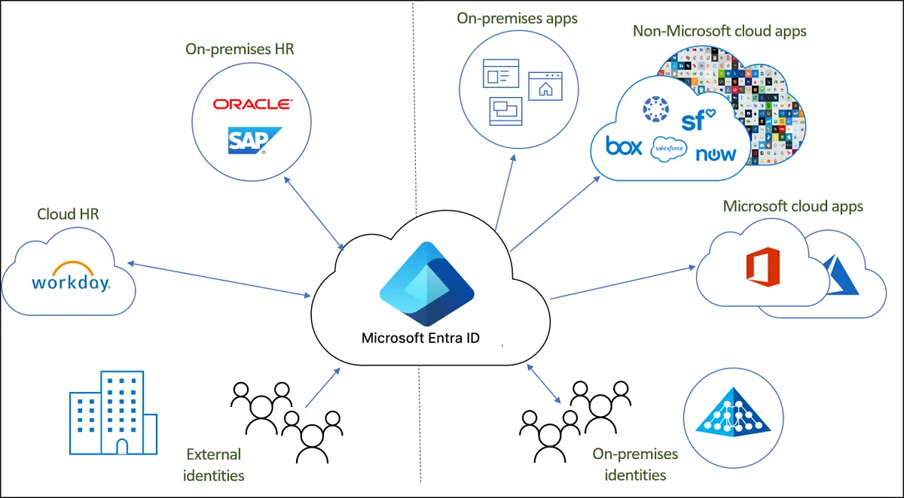
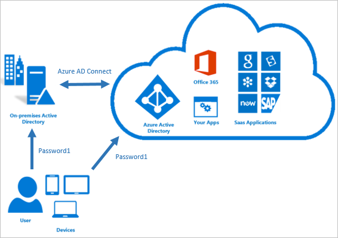
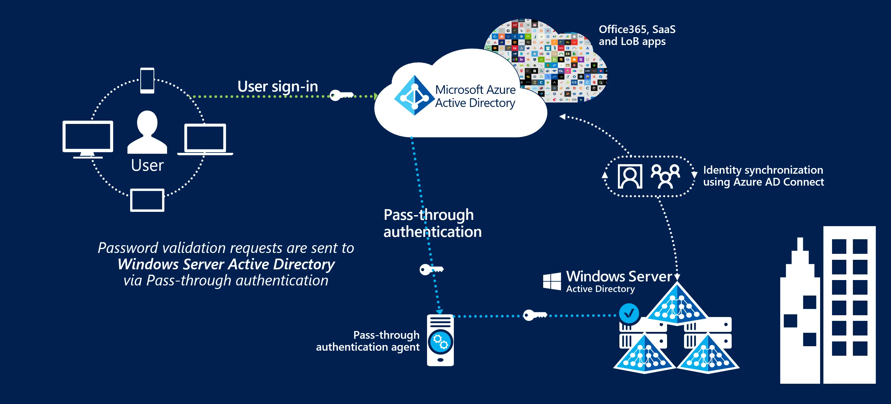
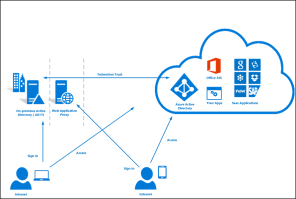
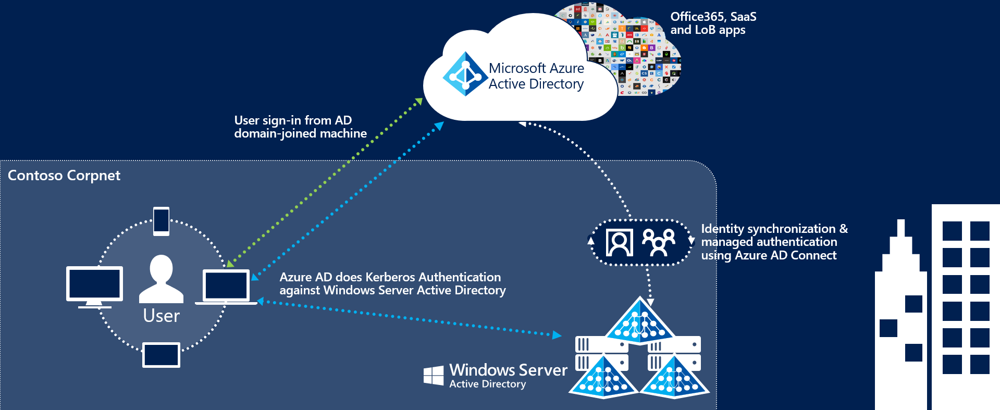

## Advanced Servers

## Hybrid Identity with Microsoft Entra ID

---

### Why Hybrid Identity Matters

- Organizations use **AD DS** for on-premises resources and **Microsoft Entra ID** for cloud applications
- An employee may need both an internal file share and Microsoft 365
- Separate accounts increase administrative work and confuse users
- **Hybrid identity** connects the two identity environments

---

### AD DS and Microsoft Entra ID

<table>
  <thead>
    <tr><th>AD DS</th><th>Microsoft Entra ID</th></tr>
  </thead>
  <tbody>
    <tr><td>On-premises directory on domain controllers</td><td>Microsoft-managed cloud identity service</td></tr>
    <tr><td>Forests and domains</td><td>Tenant</td></tr>
    <tr><td>Kerberos, NTLM, and LDAP</td><td>OAuth, OpenID Connect, and SAML</td></tr>
    <tr><td>Domain resources and Group Policy</td><td>Cloud applications and Conditional Access</td></tr>
  </tbody>
</table>

---

### One User, Two Directories

- A user has an object in on-premises AD DS and a related object in Entra ID
- Synchronization keeps selected identity information consistent
- The directories remain separate services with different capabilities
- The user can access resources in both environments

---

### Hybrid Identity

Credit: [What is identity provisioning?](https://learn.microsoft.com/en-us/entra/identity/hybrid/what-is-provisioning)

---

### Single Forest and Single Tenant

- One AD DS forest supplies identities to one Microsoft Entra tenant
- A synchronization service connects the two directories
- A selected authentication method determines how cloud sign-in works
- Entra ID issues tokens that cloud applications use to grant access

---

### Sync, AuthN, and SSO

- **Provisioning and synchronization:** Create corresponding objects and keep selected attributes consistent
- **Authentication:** Verify the user's identity during sign-in
- **Single sign-on (SSO):** Allow access without repeated credential prompts
- Synchronizing an account alone does not provide SSO

---

### Provisioning and Synchronization

- Administrators select which users and groups should synchronize
- The synchronization service detects changes and updates cloud objects
- Changes can include names, group memberships, and account status
- Password hash synchronization is an additional feature used with PHS authentication
- Example: Updating a user's display name in AD DS updates the corresponding cloud identity after synchronization

---

### Source of Authority

- In this design, AD DS remains the source for most synchronized user attributes
- Administrators make those changes in AD DS
- Synchronization exports the changes to Entra ID
- Cloud services manage cloud-specific settings, such as application access policies
- Synchronization introduces a delay between an on-premises change and its cloud effect

---

### Synchronization Platforms

- **Microsoft Entra Connect Sync:** A full synchronization engine running on-premises
- **Microsoft Entra Cloud Sync:** Lightweight on-premises agents with cloud-managed configuration
- Both can connect a single forest to a single tenant
- The organization's feature requirements determine which platform fits
- These services synchronize identities, while the sign-in method determines password validation

---

### User Sign-In Names

- A **User Principal Name (UPN)** looks like an email address: `alex@contoso.com`
- The UPN commonly becomes the user's Entra ID sign-in name
- A public domain must be verified in the tenant before users can use it as their cloud sign-in suffix
- An AD domain such as `contoso.internal` can remain unchanged while users receive the UPN suffix `contoso.com`
- Example: Alex uses `alex@contoso.com` to sign in to Microsoft 365

---

### Authentication Choices

- **Password Hash Synchronization (PHS):** Entra ID validates the password in the cloud
- **Pass-through Authentication (PTA):** An on-premises agent validates the password against AD DS
- **Federation:** Entra ID redirects authentication to a trusted identity provider
- All three approaches require a corresponding user object in Entra ID
- The main comparison is **where authentication happens and what it depends on**

---

### Password Hash Synchronization

- PHS synchronizes a derived hash of the user's AD password hash
- Entra ID validates cloud password sign-ins
- Users enter the same password they use with AD DS
- The clear-text password and original reusable AD password hash are never synchronized to Entra ID

---

### Password Hash Synchronization

Credit: [What is password hash synchronization?](https://learn.microsoft.com/en-us/entra/identity/hybrid/connect/whatis-phs)

---

### PHS Authentication Flow

1. The synchronization service sends the password-derived hash to Entra ID beforehand
2. The user enters credentials on the Entra sign-in page
3. Entra ID validates the password using its stored password-derived hash
4. Entra ID applies relevant access requirements and issues tokens when sign-in succeeds

---

### PHS Strengths and Limitations

- Requires little on-premises authentication infrastructure
- Cloud password sign-in can continue during an on-premises outage
- Password and account changes take time to reach the cloud
- AD account lockout and password-expired states are not directly synchronized
- Entra ID stores a password-derived hash for cloud authentication

---

### Pass-through Authentication

- PTA validates cloud password sign-ins against on-premises AD DS
- The user enters credentials on the Entra sign-in page
- An on-premises authentication agent handles the validation request
- Entra ID still applies cloud access policies and issues application tokens

---

### Pass-through Authentication

Credit: [What is pass-through authentication?](https://learn.microsoft.com/en-us/entra/identity/hybrid/connect/how-to-connect-pta)

---

### PTA Authentication Flow

1. The user submits credentials to Entra ID
2. Entra ID queues an encrypted validation request
3. An on-premises agent retrieves the request and checks the credentials with a domain controller
4. The agent returns the result to Entra ID

---

### PTA Strengths and Limitations

- Checks AD account conditions such as lockout and sign-in hours during password validation
- Avoids storing a password-derived hash in Entra ID for the primary sign-in method
- Depends on working agents, domain controllers, and connectivity
- Multiple agents improve availability
- PHS can provide backup authentication, but switching to it requires an administrative change

---

### Federated Authentication

- Federation establishes trust between Entra ID and another identity provider
- **Active Directory Federation Services (AD FS)** is an on-premises example
- The trusted provider authenticates users and returns a signed assertion
- Entra ID validates the assertion before issuing cloud application tokens

---

### Federated Authentication

Credit:[What is federation with Microsoft Entra ID](https://learn.microsoft.com/en-us/entra/identity/hybrid/connect/whatis-fed)

---

### Federation Authentication Flow

1. A user requests access to a cloud application
2. Entra ID redirects the browser to the trusted identity provider
3. The provider authenticates the user and returns a signed assertion
4. Entra ID validates the assertion and issues tokens

---

### Federation Strengths and Limitations

- Supports specialized authentication requirements and existing identity providers
- AD FS can authenticate users against on-premises AD DS
- An AD FS design adds servers, certificates, and service availability requirements
- Cloud sign-in depends on the federation provider remaining reachable
- Federation requires more operational work than PHS

---

### AuthN Method Comparison

<table>
  <thead>
    <tr>
      <th>Feature</th>
      <th>PHS</th>
      <th>PTA</th>
      <th>Federation</th>
    </tr>
  </thead>
  <tbody>
    <tr>
      <td>Password validation</td>
      <td>Entra ID</td>
      <td>AD DS through agent</td>
      <td>AD FS or other provider</td>
    </tr>
    <tr>
      <td>On-premises sign-in dependency</td>
      <td>No</td>
      <td>Yes</td>
      <td>Yes</td>
    </tr>
    <tr>
      <td>Complexity</td>
      <td>Low</td>
      <td>Medium</td>
      <td>High</td>
    </tr>
    <tr>
      <td>Normal recommendation</td>
      <td>Default</td>
      <td>When AD validation is required</td>
      <td>For specialized requirements</td>
    </tr>
  </tbody>
</table>

---

### Choosing an AuthN Method

- Start by evaluating **PHS** for a simple, resilient cloud sign-in design
- Consider **PTA** when cloud password sign-ins must validate against AD DS
- Consider **federation** when a required feature depends on another identity provider
- Include service availability and recovery in the decision
- A more complex method needs a clear organizational requirement

---

### Same Password or Single Sign-On?

- PHS and PTA let users use the same password in both environments
- A user who enters that password again for Microsoft 365 still receives another prompt
- **SSO** allows the user to access supported applications without entering credentials again
- Authentication methods and SSO solve different parts of the sign-in experience

---

### Device Identity and Modern SSO

- **Microsoft Entra joined:** A device joins Entra ID directly
- **Microsoft Entra hybrid joined:** A device joins AD DS and also has an identity in Entra ID
- Supported Windows sign-ins can obtain a **Primary Refresh Token (PRT)**
- The PRT helps the device obtain application tokens and provide SSO
- Access policies may still require additional authentication

---

### Microsoft Entra Seamless SSO

- Seamless SSO works with PHS or PTA
- It uses Kerberos for supported domain-joined devices on the corporate network
- Users can access supported cloud applications with fewer credential prompts
- If Seamless SSO is unavailable, users can receive the normal sign-in page

---

### Microsoft Entra Seamless SSO

Credit: [Microsoft Entra seamless single sign-on](https://learn.microsoft.com/en-us/entra/identity/hybrid/connect/how-to-connect-sso)

---

### Availability During an Outage

- **PHS:** New cloud password sign-ins can continue using the last synchronized credentials
- **PTA:** New password validation fails if no agent can reach a domain controller
- **AD FS federation:** New federated authentication fails if the required federation services are unavailable
- An outage also delays synchronization of new account and password changes
- Existing application sessions may continue until tokens expire or policies require reauthentication

---

### Security Practices

- Require MFA and apply appropriate Conditional Access policies
- Maintain cloud-only emergency access accounts
- Restrict administrative access to synchronization and authentication servers
- Monitor synchronization health and cloud sign-in activity
- Plan for account-change delays and recovery from authentication outages

---

### Scenario Questions

1. The organization wants the simplest and most resilient cloud sign-in method. Which method fits best?
2. Every password sign-in must immediately respect AD account lockout and sign-in hours. Which method fits best?
3. The organization requires an existing third-party federation provider. Which method fits best?
4. The main office loses connectivity to its domain controllers. Which method is most likely to keep cloud sign-in working?

---

### Scenario Answers

1. **Password Hash Synchronization**
2. **Pass-through Authentication**
3. **Federated Authentication**
4. **Password Hash Synchronization**

---

### Key Takeaways

- Hybrid identity connects related identities in AD DS and Entra ID
- Synchronization keeps selected directory information consistent
- PHS, PTA, and federation differ in validation location and service dependencies
- SSO reduces repeated credential prompts
- Authentication design affects both security and availability

---

### Resources

- [What is hybrid identity with Microsoft Entra ID?](https://learn.microsoft.com/en-us/entra/identity/hybrid/whatis-hybrid-identity)
- [Choose the right authentication method](https://learn.microsoft.com/en-us/entra/identity/hybrid/connect/choose-ad-authn)
- [Microsoft Entra Connect supported topologies](https://learn.microsoft.com/en-us/entra/identity/hybrid/connect/plan-connect-topologies)
- [Microsoft Entra Cloud Sync decision guide](https://learn.microsoft.com/en-us/entra/identity/hybrid/cloud-sync/connect-to-cloud-sync-decision-guide)
- [Microsoft Entra seamless single sign-on](https://learn.microsoft.com/en-us/entra/identity/hybrid/connect/how-to-connect-sso)
